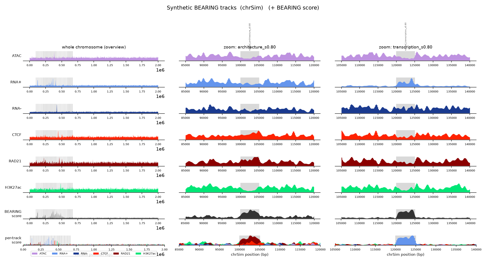
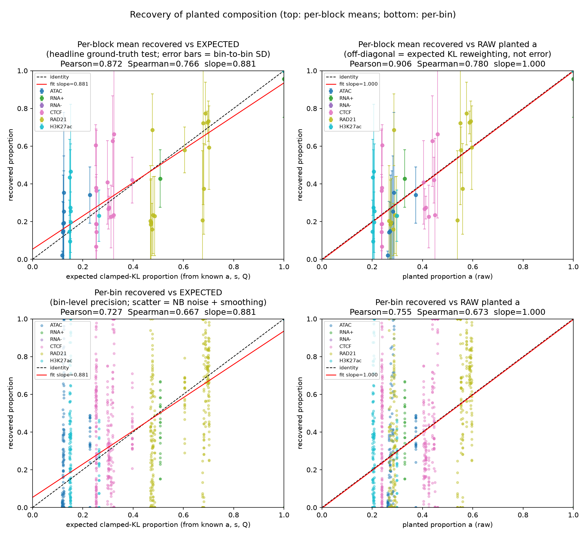
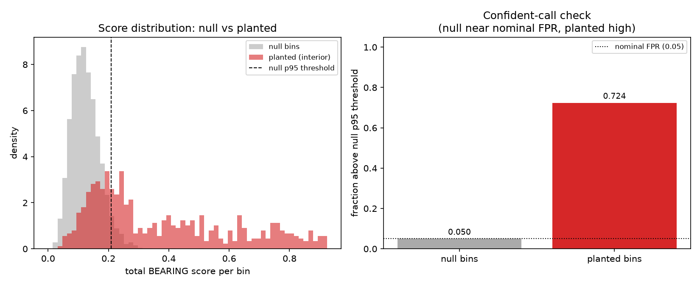

# BEARING Quickstart (5 minutes, no data required)

This runs the **real** BEARING scoring pipeline end-to-end on a small simulated
chromosome, so a reviewer can confirm the code works without downloading any
BigWig, Hi-C, or GEO files. It is the same path exercised by continuous
integration (`.github/workflows/test.yml`).

## 1. Install (pip is enough for the core scoring path)

```bash
git clone https://github.com/khayer/bearing.git
cd bearing
pip install -e ".[test]"      # core stack + entry points + pytest/h5py
```

For the Hi-C figure scripts and the full workflow you need the conda
environment instead (adds hicexplorer, pygenometracks, snakemake, bgzip/tabix,
and pytest):

```bash
conda env create -f environment.yml
conda activate bearing        # includes pytest; `pytest -q` works immediately
```

## 2. Run the test suite (~15 s)

```bash
pytest -q
# expected: 228 passed  (conda env or pip install -e ".[test]")
# a bare `pip install -e .` gives 227 passed, 1 skipped: the .mcool loader
# test needs h5py
```

The core-library tests (`tests/test_core_characterization.py`) run on the tiny
simulated fixtures in `tests/data/` (see its README); no real data is needed.

## 3. Simulate a tiny chromosome with known ground truth

```bash
python benchmark/simulate_bearing_tracks.py \
  --prefix sim --chrom chrSim --length 2000000 --bin-size 200 --seed 1
```

This writes six synthetic BigWigs (`sim_atac.bw`, `sim_rnaplus.bw`,
`sim_rnaminus.bw`, `sim_ctcf.bw`, `sim_rad21.bw`, `sim_h3k27ac.bw`), a
`sim.chrom.sizes`, and a `sim_truth.tsv` recording the planted composition.

## 4. Score the BigWigs into a qcat file

```bash
python bigwig_to_qcat.py \
  --bw sim_atac.bw sim_rnaplus.bw sim_rnaminus.bw \
       sim_ctcf.bw sim_rad21.bw sim_h3k27ac.bw \
  --sample-name sim \
  --categories categories/mm10_6track_panel.yaml \
  --chrom-sizes sim.chrom.sizes --chroms chrSim \
  --out sim.qcat.bgz --jobs 2
```

## 5. Confirm the output has real (non-zero) scores

```bash
test -s sim.qcat.bgz
zcat sim.qcat.bgz | head -2
# each line: chrSim  start  end  id:N,qcat:[[score,track], ...]
```

## 6. Plot the scores against the planted blocks

```bash
python benchmark/visualize_bearing_tracks.py --prefix sim --qcat sim.qcat.bgz \
  --out sim_tracks.png
```

`sim_tracks.png` should look like this (seed 1):



Check for:

- **Left (whole chromosome):** the grey stripes are the planted blocks. The
  **BEARING score** row peaks inside them and stays flat everywhere else.
- **Middle (`architecture` block):** the score rises over the block, and the
  **per-track score** there is mostly RAD21 (dark red) plus CTCF (red).
- **Right (`transcription` block):** the per-track score is almost all RNA+
  (light blue).

## 7. (Optional) Check recovery against the ground truth (~20 s)

```bash
python benchmark/evaluate_bearing_recovery.py --truth sim_truth.tsv \
  --bw sim_atac.bw sim_rnaplus.bw sim_rnaminus.bw sim_ctcf.bw sim_rad21.bw sim_h3k27ac.bw \
  --chrom-sizes sim.chrom.sizes --scorer bigwig_to_qcat.py --outdir eval \
  --min-signal-grid 0.01,0.1 --epsilon-grid 1e-6
cat eval/recovery_summary.txt
```

Expected headline numbers in `eval/recovery_summary.txt`:

```text
PER-BLOCK mean vs EXPECTED (headline): Pearson=0.872 Spearman=0.766 slope=0.881 n=60
Panel d (null behavior): ... null fraction above threshold=0.050, planted fraction above threshold=0.724
```

`eval/fig_a_recovered_vs_planted.png`: recovered vs planted proportions
should follow the diagonal.



`eval/fig_d_null_vs_planted.png`: about 5% of null bins pass the null p95
threshold (the nominal rate), compared with about 70% of planted bins.



If your plots match, the install works end to end:
**simulate -> score -> plot -> evaluate**. Everything else in the repository
builds on the qcat files from step 4. Small numeric differences across
platforms or library versions are fine; flat scores, or peaks outside the
planted blocks, mean something is wrong.

---

## Next steps on real data

Once the synthetic run works, the same commands apply to real BigWigs via a
sample sheet. See `docs/working_examples.md` for the full templates. The short
version:

```bash
# score a whole sample sheet
python bigwig_to_qcat.py --sheet samples_template.tsv --out placeholder.qcat.bgz --jobs 8

# multi-sample QC + differential qcat (JSD, Spearman, PCA, diff files)
python compare_qcat.py --sheet samples_template.tsv --out comparison \
  --regions-file regions_template.tsv --consensus-q --workers 4

# empirical permutation p-values
python generate_perm_nulls.py --sheet samples_template.tsv \
  --diff-sheet samples_template.tsv --compare-consensus-q --n-perms 5 --out-dir perm
python bearing_pvalue.py --qcat comparison/diff_WT_vs_KO.qcat.bgz \
  --null-qcat perm/perm1/diff_comparison/diff_WT_vs_KO.qcat.bgz \
  --diff --out-prefix results/diff_WT_vs_KO --fdr 0.05 --score-plot
```

## Full pipeline (Snakemake)

Edit `workflow/config/config.yaml`, then:

```bash
snakemake -s workflow/Snakefile --configfile workflow/config/config.yaml --cores 16
```

## Reproducing the manuscript figures

`paper/README.md` maps every figure and table to the exact script(s) that
produce it. Run the core workflow first to generate the qcat / differential /
p-value inputs those scripts consume.
